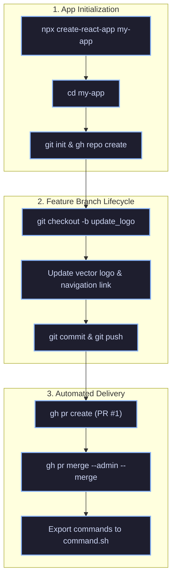

<div align="center">

  # ⚡ My React App

  <p align="center">
    <b>A modern, high-performance React single-page application built with automated DevOps & continuous delivery workflows.</b>
  </p>

  <p align="center">
    <a href="https://react.dev">
      
    </a>
    <a href="https://developer.mozilla.org/en-US/docs/Web/JavaScript">
      
    </a>
    <a href="https://github.com/zeeshansaeed6/my-app">
      
    </a>
    <a href="https://github.com/zeeshansaeed6/my-app/pull/1">
      
    </a>
    <a href="LICENSE">
      
    </a>
  </p>

  <p align="center">
    <a href="#-features">Features</a> •
    <a href="#-quick-start">Quick Start</a> •
    <a href="#-tech-stack">Tech Stack</a> •
    <a href="#-devops-automation-pipeline">DevOps Pipeline</a> •
    <a href="#-project-architecture">Architecture</a> •
    <a href="#-author">Author</a>
  </p>

</div>

---

## 🌟 Highlights & Key Features

<table>
  <tr>
    <td width="50%">
      <h3>⚡ Blazing Fast UI</h3>
      <p>Engineered with modular React components and an optimized asset pipeline for sub-second rendering and fluid interactions.</p>
    </td>
    <td width="50%">
      <h3>🤖 Automated DevOps</h3>
      <p>Fully automated branch management, pull request generation, and bypass merging using the official GitHub CLI (<code>gh</code>).</p>
    </td>
  </tr>
  <tr>
    <td width="50%">
      <h3>🎨 Responsive Design</h3>
      <p>Clean modern UI with vector assets, dynamic animations, and seamless cross-device screen responsiveness.</p>
    </td>
    <td width="50%">
      <h3>📜 Auditable Automation</h3>
      <p>Every terminal command is cataloged in <a href="command.sh"><code>command.sh</code></a> for complete reproducibility and verification.</p>
    </td>
  </tr>
</table>

---

## 🛠 Tech Stack

<div align="center">

| Layer | Technology | Description |
| :--- | :--- | :--- |
| **Frontend Core** | `React 18` | Virtual DOM rendering & state management |
| **Styling & Assets**| `CSS3` & `SVG` | Flexible layouts & scalable vector branding |
| **Tooling & Build** | `Create React App` / `Webpack` | Zero-config build pipeline & dev server |
| **Version Control** | `Git` | Distributed source code versioning |
| **CI / CD Tooling** | `GitHub CLI (gh)` | Programmatic repo, PR, and merge automation |

</div>

---

## 🔄 DevOps Automation Pipeline

The repository lifecycle is automated end-to-end through sequential CLI scripts:



### Automation Log

| Step | Action | Command | Status |
| :--: | :--- | :--- | :---: |
| `01` | Bootstrap Project | `npx create-react-app my-app` | ✅ Done |
| `02` | Create GitHub Repo | `gh repo create my-app --public --source=. --remote=origin --push` | ✅ Done |
| `03` | Branch Out | `git checkout -b update_logo` | ✅ Done |
| `04` | Asset Replacement | `curl -sL <logo_url> -o src/logo.svg` | ✅ Done |
| `05` | Route / Link Update | Updated `href` in `src/App.js` | ✅ Done |
| `06` | Stage & Push | `git commit -m "Update logo and link"` | ✅ Done |
| `07` | Open Pull Request | `gh pr create --base master --head update_logo` | ✅ Done |
| `08` | Direct Merge | `gh pr merge 1 --admin --merge` | ✅ Merged |
| `09` | Workflow Script | Saved to [`command.sh`](command.sh) | ✅ Done |

---

## 📁 Project Architecture

```graphql
my-app/
├── 📂 public/
│   ├── 📄 favicon.ico       # Application favicon
│   ├── 📄 index.html        # Main HTML mount template
│   ├── 📄 manifest.json     # PWA progressive web app metadata
│   └── 📄 robots.txt        # Search engine crawlers policy
├── 📂 src/
│   ├── 📄 App.css           # Core styling and animations
│   ├── ⚛️ App.js            # Main application component & routes
│   ├── 🧪 App.test.js       # Component test suites
│   ├── 📄 index.css         # Global CSS reset & base styles
│   ├── ⚛️ index.js          # React DOM entry point
│   ├── 🎨 logo.svg          # Modernized vector brand logo
│   └── 🧪 setupTests.js     # Jest & testing-library config
├── 📜 command.sh            # Complete automated bash script
├── 📦 package.json          # Dependencies & scripts
└── 📘 README.md             # Project documentation
```

---

## 🚀 Quick Start

### 1. Clone & Navigate
```bash
git clone https://github.com/zeeshansaeed6/my-app.git
cd my-app
```

### 2. Install Packages
```bash
npm install
```

### 3. Launch Development Server
```bash
npm start
```
> Runs the app at [http://localhost:3000](http://localhost:3000) with hot-module reloading enabled.

### 4. Production Build
```bash
npm run build
```
> Compiles and optimizes assets into the `build/` folder ready for deployment.

---

## 📜 Automation Script (`command.sh`)

You can inspect or execute the full workflow at any time:

```bash
cat command.sh
```

Or view directly online: **[command.sh](https://github.com/zeeshansaeed6/my-app/blob/master/command.sh)**

---

## 👤 Author

**Zeeshan Saeed**
- **GitHub**: [@zeeshansaeed6](https://github.com/zeeshansaeed6)
- **Repository**: [https://github.com/zeeshansaeed6/my-app](https://github.com/zeeshansaeed6/my-app)
- **Pull Request #1**: [Merged on master](https://github.com/zeeshansaeed6/my-app/pull/1)

---

<div align="center">
  <sub>Built with ❤️ using React & GitHub CLI • MIT License</sub>
</div>
