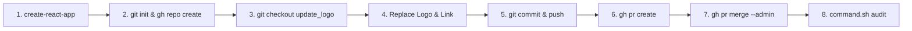

# 🚀 Propeller Aero React App

<div align="center">

  

  <br/><br/>

  [](https://react.dev)
  [](https://github.com/zeeshansaeed6/my-app)
  [](https://github.com/zeeshansaeed6/my-app/pull/1)
  [](LICENSE)

  <p align="center">
    A modernized React application featuring automated Git & CI/CD workflows, custom branding integration for <b>Propeller Aero DirtMate</b>, and automated branch lifecycle management via GitHub CLI.
  </p>

  [Explore App](https://www.propelleraero.com/dirtmate/) • [View Pull Request](https://github.com/zeeshansaeed6/my-app/pull/1) • [Automated Script](command.sh)

</div>

---

## 📌 Table of Contents

- [Overview](#-overview)
- [Tech Stack](#-tech-stack)
- [Workflow Automation](#-workflow-automation)
- [Project Structure](#-project-structure)
- [Quick Start](#-quick-start)
- [Git Workflow & PR History](#-git-workflow--pr-history)
- [Author](#-author)

---

## 📖 Overview

This repository demonstrates an end-to-end automated Software Engineering task workflow:
1. Bootstrapped a responsive React SPA using `create-react-app`.
2. Initialized Git version control and provisioned a public GitHub repository with `gh cli`.
3. Created an isolated feature branch `update_logo`.
4. Replaced default assets with the official **Propeller Aero** vector logo and integrated the **DirtMate** destination URL.
5. Pushed upstream, initiated Pull Request `#1`, and automatically merged into `master` using administrator privileges.
6. Documented all operations within an executable automation script ([`command.sh`](command.sh)).

---

## 🛠 Tech Stack

| Technology | Purpose |
| :--- | :--- |
| **React 18** | Frontend library for UI components |
| **HTML5 / SVG** | Scalable vector graphics and markup |
| **CSS3** | Modern styling and responsive layouts |
| **GitHub CLI (`gh`)** | Automated repository provisioning, PR lifecycle, and merging |
| **Git** | Distributed version control and branch branching strategy |

---

## ⚡ Workflow Automation

All execution steps were orchestrated sequentially via the terminal and recorded in [`command.sh`](command.sh):



### Script Execution Summary

| Step | Action | Command |
| :--: | :----- | :------ |
| **01** | Create React App | `npx create-react-app my-app` |
| **02** | Initialize & Publish Repo | `gh repo create my-app --public --source=. --remote=origin --push` |
| **03** | Branch Switch | `git checkout -b update_logo` |
| **04** | Update Brand Logo | `curl -sL <logo_url> -o src/logo.svg` |
| **05** | Update App Link | Update `href` in `src/App.js` to DirtMate |
| **06** | Stage & Push | `git commit -m "Update logo and link"` & `git push -u origin update_logo` |
| **07** | Create Pull Request | `gh pr create --base master --head update_logo` |
| **08** | Merge Pull Request | `gh pr merge 1 --admin --merge` |
| **09** | Export Commands | Record execution log in `command.sh` |

---

## 📂 Project Structure

```bash
my-app/
├── public/
│   ├── favicon.ico
│   ├── index.html
│   ├── manifest.json
│   └── robots.txt
├── src/
│   ├── App.css
│   ├── App.js           # Integrated with DirtMate link
│   ├── App.test.js
│   ├── index.css
│   ├── index.js
│   ├── logo.svg         # Propeller Aero vector logo
│   └── setupTests.js
├── command.sh           # Bash script of all automated CLI commands
├── package.json
└── README.md
```

---

## 🚀 Quick Start

### Prerequisites
- [Node.js](https://nodejs.org/) (v16 or higher)
- [npm](https://www.npmjs.com/) or [yarn](https://yarnpkg.com/)
- [GitHub CLI](https://cli.github.com/)

### 1. Clone the repository
```bash
git clone https://github.com/zeeshansaeed6/my-app.git
cd my-app
```

### 2. Install dependencies
```bash
npm install
```

### 3. Run development server
```bash
npm start
```
Open [http://localhost:3000](http://localhost:3000) to view the application in your browser.

### 4. Build for production
```bash
npm run build
```

---

## 🔄 Git Workflow & PR History

- **Repository**: [`zeeshansaeed6/my-app`](https://github.com/zeeshansaeed6/my-app)
- **Base Branch**: `master`
- **Feature Branch**: `update_logo`
- **Pull Request**: [#1 Update logo and link](https://github.com/zeeshansaeed6/my-app/pull/1) — **Status: MERGED**
- **Changes Merged**:
  - `src/logo.svg`: Replaced React logo with Propeller Aero SVG.
  - `src/App.js`: Pointed landing link to [Propeller Aero DirtMate](https://www.propelleraero.com/dirtmate/).

---

## 👤 Author

**Zeeshan Saeed**
- GitHub: [@zeeshansaeed6](https://github.com/zeeshansaeed6)
- Repository: [https://github.com/zeeshansaeed6/my-app](https://github.com/zeeshansaeed6/my-app)
